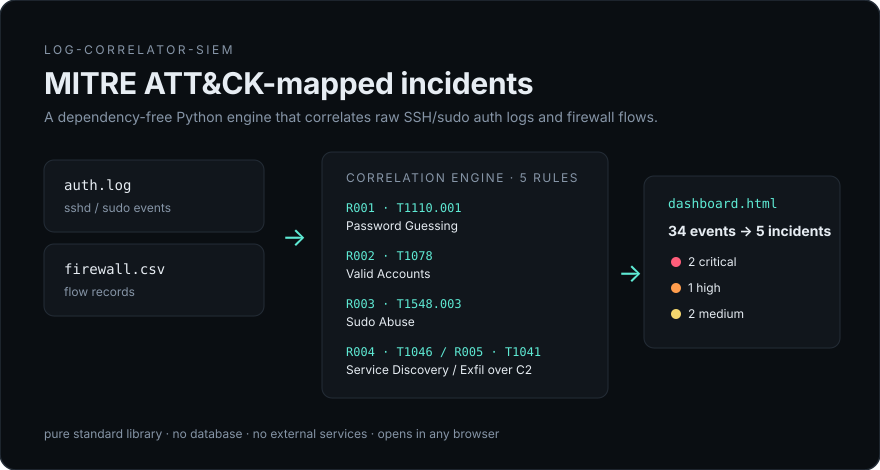
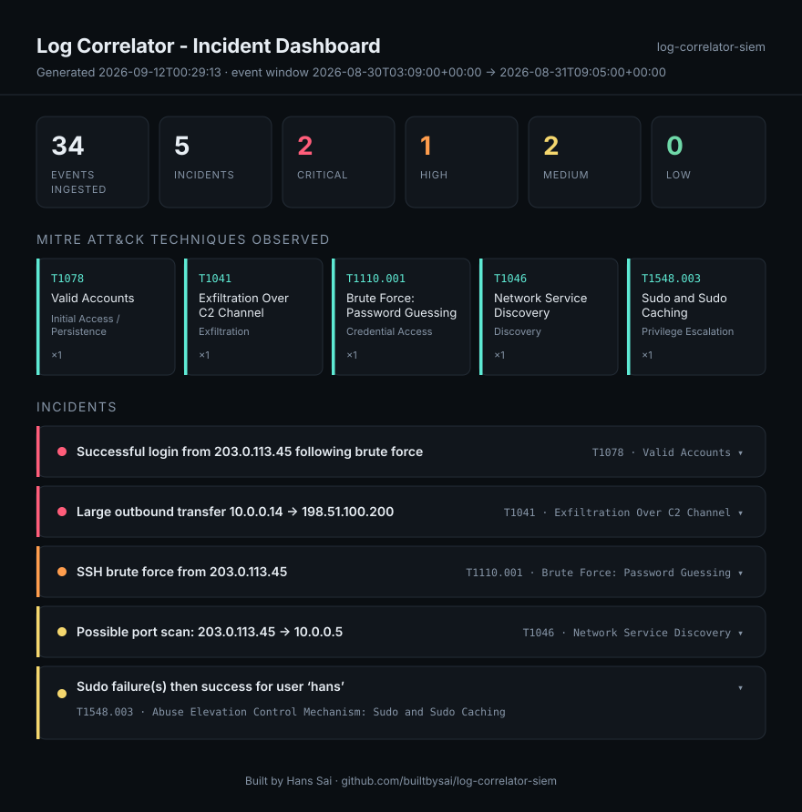
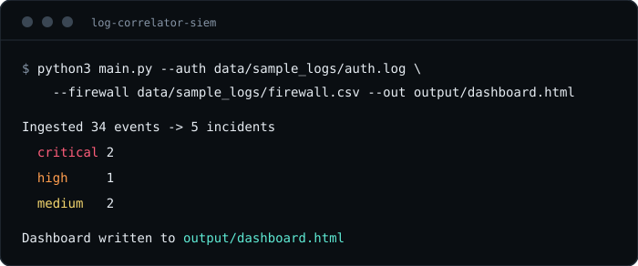

# log-correlator-siem

A small, dependency-free log correlation engine that turns raw SSH/sudo auth
logs and firewall flow logs into MITRE ATT&CK-mapped incidents, and renders
them as a self-contained HTML dashboard. No database, no external services,
no build step — clone it, point it at logs, open the HTML file it produces.

**[View the live sample dashboard →](https://builtbysai.github.io/log-correlator-siem/)**
(rendered from the bundled synthetic dataset in `data/sample_logs/`)

<p align="center">
  
</p>

<p align="center">
  
</p>

## Why

Most public "SIEM" demos are either a 40-container ELK/Wazuh stack, or a
single regex that flags one log line at a time. This sits in between: it
correlates *sequences* of events across sources — a burst of failed SSH
logins immediately followed by a successful one from the same IP is a
different, more urgent finding than either event alone — and maps each
finding to the specific ATT&CK technique it demonstrates, the way an actual
detection engineering rule set does.

## What it detects

| Rule | MITRE ATT&CK | Technique |
|---|---|---|
| R001 | T1110.001 | Brute Force: Password Guessing |
| R002 | T1078 | Valid Accounts (success following a brute-force burst) |
| R003 | T1548.003 | Abuse Elevation Control Mechanism: Sudo and Sudo Caching |
| R004 | T1046 | Network Service Discovery (port scan shape) |
| R005 | T1041 | Exfiltration Over C2 Channel (large outbound transfer) |

Each rule lives in its own function in `src/log_correlator/rules.py` with
its own unit tests — see [Design notes](#design-notes) for why.

## Quick start

```bash
git clone https://github.com/builtbysai/log-correlator-siem.git
cd log-correlator-siem
python3 main.py --auth data/sample_logs/auth.log --firewall data/sample_logs/firewall.csv --out output/dashboard.html
open output/dashboard.html   # or just double-click it
```

No `pip install` is required to run the tool itself — the correlation engine
and dashboard renderer are pure standard library. `pytest` is only needed to
run the test suite.

<p align="center">
  
</p>

### Run against your own logs

* **Auth log** — one event per line, rsyslog/sshd/sudo style with an ISO 8601
  timestamp: `2026-08-30T03:14:02+00:00 web01 sshd[1204]: Failed password for invalid user admin from 203.0.113.45 port 51422 ssh2`
* **Firewall log** — CSV with header `timestamp,src_ip,dst_ip,dst_port,protocol,action,bytes`

Malformed lines are skipped (with a count printed to stderr), not fatal —
point it at real logs without pre-cleaning them first.

```bash
python3 main.py --auth /var/log/auth.log --firewall /path/to/flows.csv \
  --out output/dashboard.html --json output/incidents.json
```

## Running the tests

```bash
pip install -r requirements.txt
pytest -v
```

35 tests cover the parsers, every rule in isolation (including negative
cases — a burst that stays *under* threshold, an unrelated success that
should *not* get linked to a brute-force incident, etc.), and an end-to-end
run against the bundled sample data.

## Design notes

- **Rules are pure functions.** `rule(events, ...) -> list[Incident]` takes
  a list of events and returns incidents; it never mutates its input and
  holds no state between calls. That makes each detection independently
  testable and easy to tune (thresholds are keyword arguments) without
  touching the others.
- **Correlation, not just matching.** R002 (Valid Accounts) only fires by
  referencing the *output* of R001 (Brute Force) — it looks for a successful
  login from an IP that already has an open brute-force incident. This
  two-stage pattern (raw detections → incidents that reference other
  incidents) is closer to how real correlation/SOAR rules chain together
  than a flat list of independent regexes.
- **No framework, no external dependency, at runtime.** The dashboard is
  rendered as one HTML string with inlined CSS and a handful of lines of
  vanilla JS for the expand/collapse cards — it opens the same way in a
  browser five years from now as it does today.
- **Fails soft on bad input.** A log line that doesn't match any known
  pattern is skipped and counted, not raised — real logs are messy, and a
  tool that throws on the first unexpected line is not usable against them.

## Roadmap

- Additional rules: impossible-travel (same user, two source IPs, too close
  in time), repeated 404/403 probing (T1595), DNS tunneling heuristics.
- A pluggable rule registry (`@register_rule`) so rules can be added without
  editing `correlator.py`.
- JSONL/Sysmon and cloud audit-log (CloudTrail/Entra) parsers alongside the
  current auth/firewall ones.

## About

Built by [Hans Sai](https://builtbysai.com) — IT Support Associate II at
Amazon, U.S. Air Force Reservist (Cyber Systems), Cybersecurity B.S. candidate
at Liberty University (May 2026), Security+ certified with an active DoD
Secret clearance.

## License

MIT — see [LICENSE](LICENSE).
